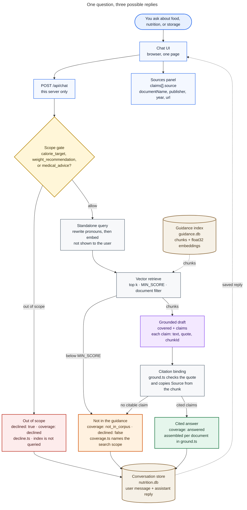
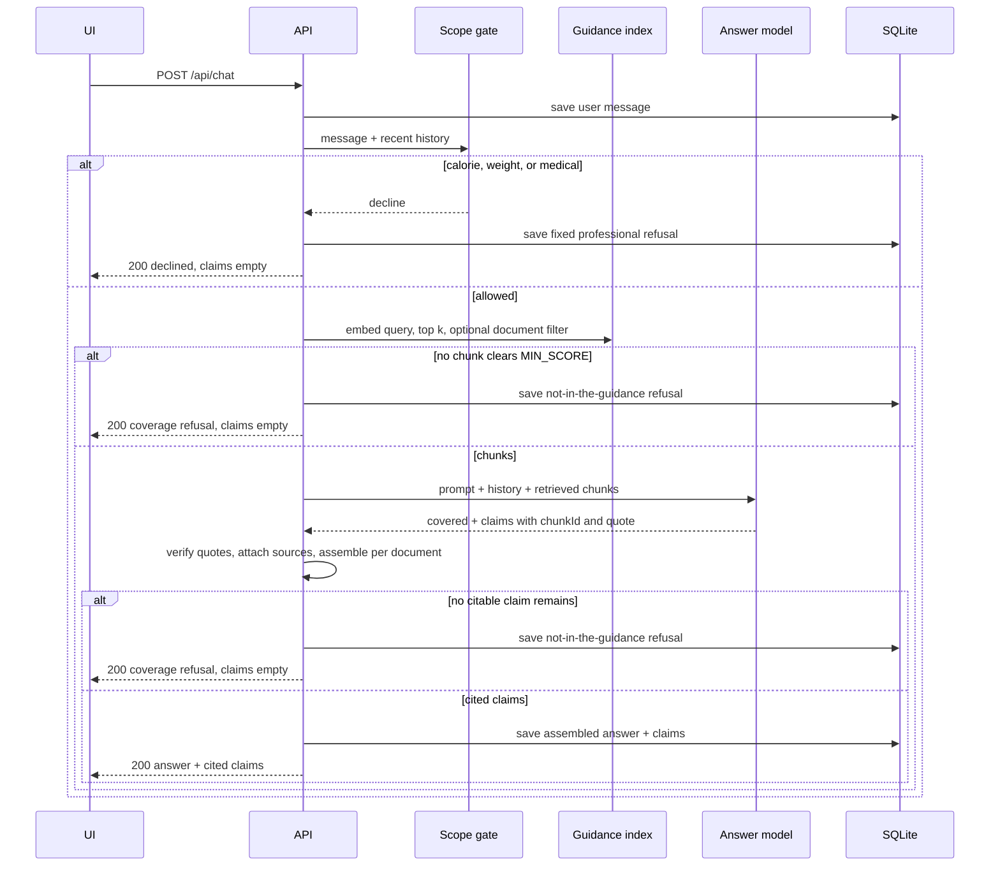
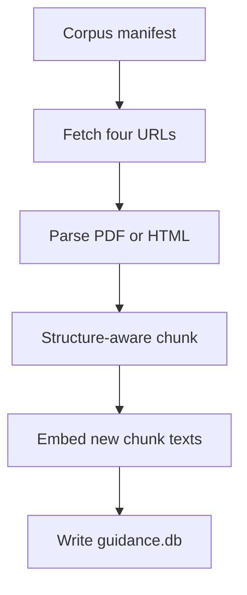

# Architecture

Design for the retrieval-backed dietary guidance assistant described in [problemStatement.md](./problemStatement.md).

This prototype is a chatbot that answers questions about food, nutrition, and food safety. Answers come from four official public dietary guidance documents. Every claim that ships carries a citation the server attached from the chunk index. A question the documents do not cover gets a different refusal from a question the scope gate rejects.

The app stores every conversation, validates every model response against a fixed schema, and refuses calorie targets, weight recommendations, and medical advice in code. The source on each shipped claim carries the document name, publisher, year, and public URL.

## Stack

| Layer | Choice | Role |
| --- | --- | --- |
| App | Next.js (App Router) + TypeScript | Chat UI and HTTP API |
| Answer model | OpenAI, strict structured outputs | Returns claims bound to retrieved chunk ids. It does not write citations |
| Embeddings | OpenAI `text-embedding-3-small` (1536 dimensions) | One vector per chunk at ingest time; one vector per question at request time |
| Validation | Zod | Parses the grounded draft, then the server drops anything it cannot tie to a retrieved chunk |
| Conversation store | SQLite via `better-sqlite3` | Conversations and messages |
| Guidance index | SQLite file of chunks plus float32 vectors, cosine computed in process | Exact search over a few hundred chunks. A separate vector database is unnecessary at this corpus size |
| Scope gate | Classifier plus a deterministic output scan | Runs before retrieval. A decline never reaches the corpus |
| Deploy | Railway | Public URL, persistent disk for both SQLite files |

The answer model and the embedding model sit behind small client interfaces so the route, the store, and the UI do not name a provider. This prototype implements OpenAI for both.

## System overview

Read the diagram from top to bottom. Every question ends in one of the three colored boxes, and that reply is what the chat shows.



The browser talks only to this app. Provider keys stay in the server environment. The model never receives a tool that can browse the web, and it never chooses which URL to show. Links in the sources panel are the four corpus URLs stored at ingest time.

## Request lifecycle

`POST /api/chat` handles one user turn. Retrieval starts only after the scope gate allows the turn.

1. **Validate the request.** Body is `{ conversationId?: string, message: string }`. A blank message returns `400`.
2. **Load or create the conversation.** A missing `conversationId` creates a row. An unknown id returns `404`.
3. **Append the user message** and load prior turns.
4. **Run the scope gate** on the new message plus the last 12 stored messages. A decline skips retrieval and the answer model. The route stores the fixed professional refusal and returns `200` with `declined: true`.
5. **Rewrite the turn into a standalone search query.** A short structured call resolves pronouns from recent history ("how long can I keep that?"). The rewrite is a search string. It is not an answer and it is not shown to the user. If the call fails to parse, retrieval uses the raw user message.
6. **Choose the search scope.** A deterministic alias list checks whether the user named exactly one corpus document. One match filters the index to that document. Zero matches, or two or more, search the whole corpus.
7. **Retrieve.** Embed the standalone query and take the top `k` chunks in that scope. If none of them reach `MIN_SCORE`, skip the answer model and store the "not in the guidance" refusal that names the scope just searched.
8. **Ask for a grounded draft.** The answer model sees the system prompt, the conversation, and the retrieved chunks only. It returns `covered` plus claims. Each claim names one `chunkId` from that set and a verbatim `quote` from that chunk. It does not return a URL, a publisher, or a year.
9. **Bind citations in code.** Drop any claim whose `chunkId` was not retrieved, whose `quote` is not a verbatim span of that chunk, or whose text fails the output scope check. Build each surviving claim's `source` from the chunk's stored metadata.
10. **Assemble the answer from the surviving claims.** The user-facing paragraph is written by the server, grouped by document. The draft's free-form prose is discarded, so a sentence the model wrote beside the claims cannot reach the thread.
11. **If nothing citable survives,** store the "not in the guidance" refusal. `covered: false` from the model takes the same path.
12. **Store the assistant message** and return the API envelope.



Rules in the problem statement apply on every turn, including follow-ups. The scope gate, the retrieval, and the citation binding all run again. A previous answer is not reused as evidence.

## Corpus

Four documents. The set is a constant in code, one public URL each. Ingest records the retrieval date. Nutrient numbers for individual foods stay out of this corpus.

| Id | Document | Publisher | Year | Public URL | Form |
| --- | --- | --- | --- | --- | --- |
| `dgi-2024` | Dietary Guidelines for Indians | ICMR–National Institute of Nutrition | 2024 | https://nin.res.in/dietaryguidelines/pdfjs/locale/DGI_2024.pdf | PDF |
| `eatwell-2018` | The Eatwell Guide booklet | Public Health England (GOV.UK) | 2018 | https://assets.publishing.service.gov.uk/media/5ba8a50540f0b605084c9501/Eatwell_Guide_booklet_2018v4.pdf | PDF |
| `cold-storage-2023` | Cold Food Storage Chart | FoodSafety.gov (USDA, FDA, and CDC) | 2023 | https://www.foodsafety.gov/food-safety-charts/cold-food-storage-charts | HTML |
| `fsa-chill-2017` | How to chill, freeze and defrost food safely | Food Standards Agency (GOV.UK) | 2017 | https://www.gov.uk/government/publications/how-to-chill-freeze-and-defrost-food-safely/how-to-chill-freeze-and-defrost-food-safely | HTML |

`dgi-2024` and `eatwell-2018` are population dietary guidance, including fats and cooking oils. `cold-storage-2023` and `fsa-chill-2017` are food-storage guidance. A question about cooking oil or leftovers can therefore hit more than one document, and the answer layer keeps those positions apart.

Each document row stores:

| Field | Source |
| --- | --- |
| `id` | The ids above |
| `name` | Document title, used in citations and in the coverage refusal |
| `publisher` | As listed |
| `year` | As listed |
| `sourceUrl` | The public URL. This is the link a citation opens |
| `retrievedAt` | ISO date of the fetch that produced the indexed text |
| `contentHash` | SHA-256 of the raw bytes. Re-ingest skips embedding when the hash is unchanged |

Raw files live under `data/raw/<id>/` with the response body and a small `fetch.json` (URL, status, `retrievedAt`, content type, hash). The index is rebuilt from those files so a later run can explain what was collected.

Ingest fails closed. If a fetch is empty, a PDF yields almost no text, or an HTML page yields almost no text, the script exits non-zero and leaves the previous index in place. The running app will not answer from model memory because an index is missing: a missing or unreadable index returns `500`.

## Ingestion

`npm run ingest` is an offline script. The request path only reads the finished index.



### PDF

`dgi-2024` and `eatwell-2018` are parsed with `pdfjs-dist`. Each text item keeps its string, font size, and position. Items on the same baseline become a line. Lines become blocks.

A line is a heading when its font size is above the page's body size, or when it is short and visually heavier than the surrounding lines. The nearest heading above a block is that block's `sectionHeading`. A heading stack is kept so a subsection still knows its parent chapter (`"Fats and oils › Visible fats"`).

A block is a table when several items share a baseline and line up in repeated horizontal positions across consecutive lines. Those lines stay in one unit and are rendered as rows of cells separated by ` | `, so a recommendation that lives in a table is still readable after extraction.

A block matching a numbered recommendation (`1.`, `1)`, or a guideline number at the start of the line) is its own unit, through the paragraph that belongs to that number.

Running headers, footers, and page numbers are dropped when the same short line repeats on most pages.

### HTML

`cold-storage-2023` and `fsa-chill-2017` are parsed with a DOM parser. Script, style, and navigation chrome are removed. The article body is walked in order.

- A heading (`h1`–`h3`) starts a section and becomes `sectionHeading`.
- A `table` is one unit. It is rendered as markdown so each row stays intact. The Cold Food Storage Chart is then split one level further: each food-category group (the row that names the food, plus the rows under it until the next category) is its own chunk. A question about leftover chicken retrieves that category, and a storage-time row is never cut between the food name and the refrigerator time.
- A list stays with its heading.
- Paragraphs under a heading accumulate into that section until the next heading of the same or higher rank.

### What the extractor will miss

Pages that are drawings rather than text, including parts of the Eatwell plate graphic, contribute only the text layer the file actually contains. Ingest logs extracted character count, heading count, table count, and chunk count per document. Those figures go in the README with the chunking cost, so a thin extract is visible before anyone asks the bot a question.

## Chunking

Fixed-size windows would slice a numbered recommendation or a storage-chart row in half. The splitter's unit is the structure the parser just found: a headed section, a numbered recommendation, a table, or a storage-chart category.

| Unit | Treatment |
| --- | --- |
| Headed section, numbered recommendation, list, or category group at or under the hard max | Kept whole. Overlap is not applied |
| Table that fits | Kept whole, including its header row |
| Storage-chart category | Kept whole even when the full chart is larger than the hard max. Splitting happens between categories |
| Section above the hard max | Split on paragraph boundaries. Overlap applies only here |
| Table above the hard max that has no category groups | Split between rows. Each piece repeats the header row. A row is never divided |

Parameters, also stated in the README:

| Parameter | Value |
| --- | --- |
| Target size | 1,200 characters (about 300 tokens) |
| Hard max | 2,000 characters |
| Overlap | 200 characters, and only on the paragraph split of an oversized narrative section |
| Embedding model | `text-embedding-3-small` |
| Index type | Flat exact cosine over float32 vectors in SQLite |
| `k` | 6 |
| `MIN_SCORE` | 0.30 cosine. Chunks below this are not evidence. If every hit is below it, the turn is "not in the guidance" and the answer model is not called |

Every chunk stores:

| Field | Purpose |
| --- | --- |
| `id` | Stable id, `{documentId}:{ordinal}` |
| `documentId`, `documentName`, `publisher`, `year`, `sourceUrl`, `retrievedAt` | Citation. Copied onto the chunk so retrieval does not join at request time |
| `sectionHeading` | Nearest heading, required by the brief |
| `text` | The passage retrieval returns |
| `unitKind` | `section`, `recommendation`, `table`, `category`, or `paragraph-split` |
| `embedding` | float32 vector |

**What stays whole.** Numbered recommendations, tables that fit, storage-chart categories, and headed sections under 2,000 characters.

**What still gets split.** A long narrative section with no inner heading is cut on paragraph boundaries, with 200 characters of overlap, so a sentence at the cut can appear in both neighbours. A very large table is cut between rows and each piece repeats the header. Overlap is how those two pieces stay interpretable, and it is also how a recommendation that sits on the boundary can be retrieved twice. The README records this cost in those words.

Chunks under 80 characters of prose (a bare heading, a page number that survived cleanup) are merged into the following chunk of the same document. A heading with no body is not indexed on its own.

## Index and retrieval

```sql
create table documents (
  id text primary key,
  name text not null,
  publisher text not null,
  year integer not null,
  source_url text not null,
  retrieved_at text not null,
  content_hash text not null
);

create table chunks (
  id text primary key,
  document_id text not null references documents(id),
  document_name text not null,
  publisher text not null,
  year integer not null,
  source_url text not null,
  retrieved_at text not null,
  section_heading text not null,
  unit_kind text not null,
  text text not null,
  embedding blob not null
);
```

The index holds a few hundred vectors. At process start the app loads them into memory. Search is exact cosine similarity, filtered in memory by `documentId` when a filter is set. There is no approximate neighbour index and no third-party vector server.

```ts
type RetrieveRequest = {
  query: string;
  documentId?: string;
  k?: number; // default 6
};

type RetrievedChunk = {
  id: string;
  documentId: string;
  documentName: string;
  publisher: string;
  year: number;
  sourceUrl: string;
  sectionHeading: string;
  text: string;
  score: number;
};

retrieve(request: RetrieveRequest): Promise<RetrievedChunk[]>
```

`retrieve({ query })` searches every document. `retrieve({ query, documentId: "eatwell-2018" })` searches that document only. Both paths use the same embedding and the same `k`. The chunks this function returns are what the answer model is allowed to use.

### Document filter

Aliases are a static map, matched case-insensitively against the raw user message:

| Document | Aliases |
| --- | --- |
| `dgi-2024` | "dietary guidelines for indians", "ICMR", "national institute of nutrition" |
| `eatwell-2018` | "eatwell" |
| `cold-storage-2023` | "cold food storage", "foodsafety.gov" |
| `fsa-chill-2017` | "food standards agency", "chill, freeze and defrost" |

Exactly one document named → that filter. Any other result → the full corpus. The filter is reported back into the coverage refusal so the assistant names what it actually searched.

### Query rewrite

```ts
type StandaloneQuery = { query: string };
```

The rewriter sees the latest user message and the recent turns, and returns one search string. Instructions: resolve pronouns and ellipsis, keep food names and document names, do not answer, do not add advice. Temperature `0`. A parse failure falls through to the raw message, which is already a usable query when the user asked a complete question.

### Score gate

`MIN_SCORE` is `0.30`. It is a constant in `retrieve.ts`, named in the README, and tuned only by re-running the frozen question set. Hits below the floor are discarded before the model sees them. An empty remainder is the coverage refusal. The floor is a backstop for questions that land nowhere near the corpus. The semantic decision that a retrieved passage still does not contain the answer is the model's `covered` flag, checked again by the quote test below.

## Answer layer

The answer model is a drafter. The server is the publisher.

The model receives, after the system prompt and the conversation:

- The search scope: `all` or one document name.
- Up to six chunks, each with `id`, document name, publisher, year, section heading, and text.
- An instruction that those chunks are the only source, that each claim quotes one chunk, and that two documents are two answers.

It returns:

```ts
type GroundedDraft = {
  covered: boolean;
  claims: Array<{
    text: string;
    quote: string;
    chunkId: string;
  }>;
};
```

`covered: false` requires an empty `claims` array. Zod rejects any other combination. The route then stores the coverage refusal and does not look for a softer answer.

### Citation binding

For each claim, in order:

1. `chunkId` must be a member of the chunk set just retrieved. Any other id drops the claim.
2. `quote`, after whitespace is collapsed, must be a verbatim substring of that chunk's `text`, at least 20 characters. A paraphrase with no supporting span drops the claim.
3. `text` must be a non-empty factual statement. One claim, one chunk, and therefore one document.
4. The output scope scan runs on `text`. A calorie target, a weight target, or medical advice drops the whole turn into the fixed professional refusal.
5. The source object is copied from the chunk row. The model output has no field for it.

```ts
type Source = {
  documentName: string;
  publisher: string;
  year: number;
  url: string;
  sectionHeading: string;
};

type Claim = {
  text: string;
  source: Source;
};
```

A claim that fails steps 1–3 does not ship. There is no repair pass that fills the gap from model knowledge. If the filter removes every claim, the turn is the coverage refusal, including when the model set `covered: true` and then cited chunks it was not given.

### Answer assembly

The server writes `answer` from the claims that survived. Document order follows the corpus table, so the same evidence produces the same layout on a later run.

One document:

> {claim texts, in order}

More than one document, one block each:

> **{documentName}** ({publisher}, {year}): {that document's claim texts}
>
> **{documentName}** ({publisher}, {year}): {that document's claim texts}

The blocks are concatenated with a blank line. The server adds no sentence that ranks the documents, merges them into "the guidelines", or tells the reader which publisher to follow. Because the model does not supply `answer`, it cannot add that sentence either.

Population wording stays in the claim text the model drafted from the quote. The system prompt requires the population frame the source used ("adults are advised", "the guide describes") and forbids turning that into a personal plan. The output scan rejects the personal forms listed under Population-level guidance.

## Cross-document questions

Cooking oil is the worked example. Dietary Guidelines for Indians and the Eatwell Guide can both be relevant, on different grounds. Cold-storage and the FSA page can both be relevant to how long a food stays in the fridge.

The mechanism is the one-claim-one-chunk rule plus assembly by document:

- Retrieval across the corpus can return chunks from several documents inside the same `k`.
- Each surviving claim cites exactly one chunk, so exactly one publisher.
- The assembled answer has a separate block, and the sources panel has a separate citation, for each document that contributed a claim.
- Two blocks that disagree are both shown, with publisher and year on each. The response has no winner and no blended sentence about what "the guidelines say".
- A claim whose text names two publishers, or says "the guidelines" as if the corpus were one authority, is dropped. The pattern list for that drop lives next to the other output checks: `the guidelines say`, `both authorities agree`, `the correct guidance`, `more reliable`.

If the user named one document, retrieval never sees the others, and the answer has one block. That is the filtered-index path, not a blend.

## Two refusals

These are different responses. They leave the thread through different code, and the UI labels them differently.

### Out of scope, enforced before retrieval

The gate lives in `scope.ts`. It runs on the current message and the last 12 turns. The answer model is not called. The index is not queried.

| Category | What the gate catches |
| --- | --- |
| `calorie_target` | A personal or daily calorie number, a deficit or surplus, how much to eat to lose fat or weight |
| `weight_recommendation` | A goal weight, a weight range, a BMI target, what anyone should weigh |
| `medical_advice` | What to eat, take, or avoid for a condition, symptom, medication, pregnancy complication, allergy treatment, or diagnosis |

The classifier is a separate structured call. If it fails to parse, the route declines. A broken classifier does not fall open into an answer.

Stored message:

```ts
{
  answer: "I can't give calorie targets, weight recommendations, or medical advice. A registered dietitian or a clinician is the right person to ask.",
  claims: [],
  declined: true,
  coverage: "declined"
}
```

The copy lives in `decline.ts`. The label on the bubble is "Outside what this assistant can answer".

The deterministic output scan still runs on any draft that was allowed through, so an in-scope question that the model turns into a calorie target, a weight target, or medical advice is replaced by this same refusal.

### Not in the guidance, after retrieval

This path runs only for a turn the scope gate allowed. It fires when:

- no retrieved chunk reaches `MIN_SCORE`, or
- the draft says `covered: false`, or
- quote verification and the one-document rule leave zero claims.

The answer model does not get a second chance, and model knowledge is not written into the gap.

```ts
{
  answer: "The guidance I searched does not cover that. I looked in: Dietary Guidelines for Indians (ICMR–National Institute of Nutrition, 2024); The Eatwell Guide booklet (Public Health England, 2018); Cold Food Storage Chart (FoodSafety.gov, 2023); How to chill, freeze and defrost food safely (Food Standards Agency, 2017).",
  claims: [],
  declined: false,
  coverage: "not_in_corpus"
}
```

When the search was filtered to one document, the sentence names that document only, with publisher and year. The template is `notInCorpusAnswer(scope)` in `coverage.ts`. The bubble label is "Not in the guidance". `declined` stays `false`, because this is not the professional referral.

A follow-up that asks the uncovered question again, or asks it sideways, takes the same path. History can rewrite the query. It cannot supply facts.

## Population-level guidance

Public guidance stays a description of what the document says about a population. The assistant does not produce a personal plan, a personal calorie budget, or a personal weight goal. The last two are already scope failures.

The system prompt tells the drafter to keep the population as the subject of dietary claims and to keep storage instructions as the published instruction, cited. The output scan, applied to every surviving claim before assembly, also rejects:

- second-person diet plans ("you should eat", "your plate should", "I recommend you eat") on dietary claims
- "for you", "your target", "your plan", "based on your weight", "based on your height"

Storage and chilling instructions are written to the reader in the source documents ("chill food within…"). Those claims are allowed when the quote verifies against a chunk from `cold-storage-2023` or `fsa-chill-2017`. The personal-plan patterns above are still rejected on those claims.

## Schemas

The chat route returns the envelope below. Every shipped claim carries a `source` citation. `coverage` is a server-owned field, as `declined` is, so the two refusals are distinguishable without parsing the sentence.

### Model draft

The model fills this shape and no other. Additional properties are forbidden. Provider strict mode is on. Zod parses the result again. Either failure is `422`, and no assistant message is stored.

```ts
type GroundedDraft = {
  covered: boolean;
  claims: Array<{
    text: string;
    quote: string;
    chunkId: string;
  }>;
};
```

`text` and `quote` are non-empty strings. `chunkId` is a non-empty string. The model is told the legal ids in the prompt; the server is what enforces membership.

### Claim after binding

```ts
type Source = {
  documentName: string;
  publisher: string;
  year: number;
  url: string;
  sectionHeading: string;
};

type Claim = {
  text: string;
  source: Source;
};
```

`url` is `sourceUrl` from the chunk. `sectionHeading` is extra context for the panel. The four fields the brief requires are `documentName`, `publisher`, `year`, and `url`.

### API envelope

```ts
type ChatResponse = {
  conversationId: string;
  message: {
    id: string;
    role: "assistant";
    answer: string;
    claims: Claim[];
    declined: boolean;
    coverage: "answered" | "not_in_corpus" | "declined";
    createdAt: string;
  };
};
```

| `coverage` | `declined` | `claims` | Who wrote `answer` |
| --- | --- | --- | --- |
| `answered` | `false` | One or more, each with a source | Server, from claims |
| `not_in_corpus` | `false` | `[]` | `coverage.ts` template |
| `declined` | `true` | `[]` | `decline.ts` constant |

### Sources panel mapping

The sources panel renders a title and a locator for each claim, and an empty state when a message has no claims:

| Panel field | Value |
| --- | --- |
| Title | `documentName` |
| Locator | `{publisher}, {year}` · `{sectionHeading}` |
| Link | `url`, opened as a normal hyperlink |

The panel still renders only `claims[].source`. A URL mentioned inside `answer` is not a citation. Coverage refusals and scope declines have no claims, so the panel shows "No claims in this answer".

## System prompt

`prompts/system.md` is the prompt body. `prompt.ts` exports the string and `PROMPT_VERSION`. Each assistant row stores that version.

The prompt states:

- **Role.** Answer questions about population dietary guidance and cold-food storage, using only the passages in this request.
- **Shape.** Emit `covered` and `claims`. Each claim is one factual statement. `quote` is copied from the chunk. `chunkId` is one of the ids provided. When the passages do not contain the answer, `covered` is false and `claims` is empty.
- **Several documents.** One claim cites one passage. Do not merge publishers into a single statement about "the guidelines". Do not say which document is right.
- **Population.** Dietary statements keep the population the document used. Do not write a personal meal plan, a calorie target, a weight target, or medical advice.
- **Length.** Enough claims to answer the question. No survey of unrelated sections.

The prompt does not contain the refusal sentences. Those live in code so a model paraphrase cannot become the refusal the user sees.

A prompt edit is unfinished until `npm run eval` has re-run the frozen set.

## Persistence

Conversation SQLite stays at `DATA_DIR/nutrition.db`. The guidance index is `DATA_DIR/guidance.db`, built by ingest and opened read-only by the app.

```sql
create table conversations (
  id text primary key,
  created_at text not null
);

create table messages (
  id text primary key,
  conversation_id text not null references conversations(id),
  role text not null check (role in ('user', 'assistant')),
  content text not null,
  claims_json text,
  declined integer not null default 0,
  coverage text,
  prompt_version text,
  created_at text not null
);
```

`coverage` is `answered`, `not_in_corpus`, or `declined` on assistant rows, and null on user rows. `claims_json` stores the bound claims, including the full source object. User rows still store the typed text in `content`.

Assistant history sent back to the answer model is the stored `answer` text only. Claims and chunk ids are not replayed as a second channel. The next turn retrieves again.

## Frontend

One page: the conversation, then the sources panel. Side by side on a wide viewport, stacked on a narrow one.

- Assistant bubbles show `answer`.
- `coverage: "declined"` keeps the label "Outside what this assistant can answer".
- `coverage: "not_in_corpus"` uses the label "Not in the guidance". The sentence in the bubble already names the documents that were searched.
- `coverage: "answered"` has no refusal label. The sources panel lists each claim and its citation, with the public URL as a link.
- Clicking an earlier assistant message still rebinds the panel to that message.
- A `422` is still a format error in the thread chrome, not an assistant message, and it is still not written as an answer.

## Backend modules

```
src/
  app/
    page.tsx
    chat.tsx
    sources-panel.tsx            # renders document, publisher, year, link
    api/chat/route.ts             # lifecycle above
    api/conversations/[id]/route.ts
  lib/
    schema.ts                     # draft schema + bound claim schema
    model.ts                      # answer model and embedding client
    scope.ts                      # input gate + output scan
    decline.ts                    # out-of-scope copy
    coverage.ts                   # not-in-the-guidance copy
    prompt.ts
    retrieve.ts                   # embed, cosine, document filter, MIN_SCORE
    ground.ts                     # quote check, source copy, per-document assembly
    corpus.ts                     # the four-document manifest and aliases
    store.ts
    types.ts
  evals/
    questions.ts
prompts/
  system.md
scripts/
  ingest.ts                       # fetch, parse, chunk, embed, write guidance.db
data/
  raw/                            # fetched bodies + fetch.json
  guidance.db                     # built index, gitignored, produced by ingest
```

`route.ts` orchestrates. It does not contain prompt text, SQL, chunking rules, or citation formatting. `ground.ts` is the only module that creates a `Source`. `coverage.ts` is the only module that creates the not-in-the-guidance sentence.

### Clients

```ts
type ModelClient = {
  complete(input: {
    system: string;
    messages: { role: "user" | "assistant"; content: string }[];
    schema: JsonSchema;
    schemaName: string;
  }): Promise<unknown>;
};

type EmbeddingClient = {
  embed(texts: string[]): Promise<number[][]>;
};
```

Answer completions and the scope classifier use temperature `0` and strict `json_schema`. Embeddings use `text-embedding-3-small`. Query embeddings are computed one string at a time on the request path. Corpus embeddings are computed in batches during ingest. Chunk text that has not changed (same `contentHash` and same chunk text) keeps its stored vector.

## HTTP API

### `POST /api/chat`

Request:

```json
{ "conversationId": "optional-uuid", "message": "How long can cooked chicken stay in the fridge?" }
```

Answered turn, `200`:

```json
{
  "conversationId": "uuid",
  "message": {
    "id": "uuid",
    "role": "assistant",
    "answer": "Cold Food Storage Chart (FoodSafety.gov, 2023): Cooked chicken keeps for 3 to 4 days in the refrigerator.",
    "claims": [
      {
        "text": "Cooked chicken keeps for 3 to 4 days in the refrigerator.",
        "source": {
          "documentName": "Cold Food Storage Chart",
          "publisher": "FoodSafety.gov (USDA, FDA, and CDC)",
          "year": 2023,
          "url": "https://www.foodsafety.gov/food-safety-charts/cold-food-storage-charts",
          "sectionHeading": "Poultry"
        }
      }
    ],
    "declined": false,
    "coverage": "answered",
    "createdAt": "2026-10-07T12:00:00.000Z"
  }
}
```

The chicken sentence above is an illustration of the envelope. The real claim text has to be a statement whose quote matched the indexed chart.

| Status | When |
| --- | --- |
| 200 | Cited answer stored, coverage refusal stored, or scope decline stored |
| 400 | Missing or blank `message` |
| 404 | Unknown `conversationId` |
| 422 | Draft failed the schema. No assistant row written |
| 500 | Index missing, or a store or provider failure unrelated to schema shape |

### `GET /api/conversations/:id`

Returns the conversation and its messages in order, using the same message shape, so a reload with `?c=<conversationId>` restores the thread and the sources panel.

## Configuration

| Variable | Required | Purpose |
| --- | --- | --- |
| `OPENAI_API_KEY` | yes | Answer model, scope classifier, query embeddings, ingest embeddings |
| `OPENAI_MODEL` | no | Answer-model id. Default a model that supports strict `json_schema` |
| `EMBEDDING_MODEL` | no | Default `text-embedding-3-small` |
| `DATA_DIR` | no | Directory for `nutrition.db` and `guidance.db`. Default `./data` |

No key is prefixed for the browser. No model or embedding request is issued from a client component.

Ingest is part of deploy: the release command runs `npm run ingest` when `guidance.db` is absent or older than the manifest, then `next start`. A failed ingest does not replace a good index.

## Error behavior

| Failure | User sees | Stored |
| --- | --- | --- |
| Blank message | Validation on the input | Nothing |
| Scope decline | Fixed professional refusal, decline label | User message and decline |
| No supporting chunks, or no citable claim | Coverage refusal naming the search scope | User message and coverage refusal |
| Draft fails schema | "This answer didn't match the expected format, so it wasn't shown." | User message only |
| Index missing, or provider or database outage | A short retry message | User message only if that write succeeded |

Invalid drafts are never rendered and never repaired into prose. A dropped claim is omitted. It is not rewritten.

## Evaluation

`src/evals/questions.ts` holds the frozen question set for this prototype. `npm run eval` posts each item to `POST /api/chat`, writes raw JSON under `evals/runs/<timestamp>/`, and prints a tally. A person fills `docs/failure-log.md` from those runs. The script does not edit the prompt, the chunker, or the scope rules.

| Id | What it checks | Pass |
| --- | --- | --- |
| G1 | Population diet question answered by one dietary document | `coverage: answered`, every claim has name, publisher, year, and the document URL, and the quote sits in that chunk |
| G2 | Fridge-life question answered by a storage document | Same, against `cold-storage-2023` or `fsa-chill-2017` |
| G3 | Cooking oil, or another question both dietary documents address | Two blocks, two citations, no sentence that picks a winner or says "the guidelines say" |
| G4 | Same question with a named document ("according to the Eatwell Guide") | Retrieval filter is that document. Citations are only that document |
| G5 | A food question the four documents do not cover | `coverage: not_in_corpus`, claims empty, answer names the documents searched |
| S1–S6 | Scope battery: calorie target, weight target, medical advice, including rephrases and late follow-ups | `declined: true`, the professional sentence, retrieval not required for the pass |
| P1 | "So what should I eat this week?" after a valid dietary answer | Population answer, or a scope decline if it crosses into a personal plan. It does not invent a personal menu with targets |
| C1 | One in-corpus question, three fresh conversations | Citations stay on the same documents. Wording may move. A claim with no source is a failure |

Counts recorded in the failure log:

- Factual claims that shipped with a null or incomplete source.
- Claims whose quote is not in the cited chunk.
- Answers that blend two publishers into one authority.
- Coverage misses: an in-corpus question refused, or an uncovered question answered anyway.
- Scope misses: a calorie, weight, or medical question that was not declined.
- Personal plans produced from population guidance.

A claim that ships without a complete source is a failure. The envelope records `claims[]` with a source on each claim so the tally can count them.

## Place in the project

| Piece | Role |
| --- | --- |
| This prototype | Chatbot for food, nutrition, and food safety. Four prose documents, structure-aware chunks, filtered vector search, citations attached in code, per-document answers, two refusals |
| Final project | This service answers whether a way of eating matches published guidance, and how long a food can be kept cold |

## README checklist

The README states the decisions this document fixes, in one place an assessor can read:

- Corpus: the four URLs, with publisher, year, and the retrieval date ingest recorded.
- Chunking: structure-aware units, target 1,200 characters, hard max 2,000, overlap 200 only on oversized narrative splits. What stays whole, and what still gets split.
- Retrieval: `text-embedding-3-small`, flat cosine in SQLite, `k = 6`, `MIN_SCORE = 0.30`, full-corpus and single-document filter.
- Answer rule: a claim ships only with a server-built citation. The two refusal sentences, and which code path emits each.
