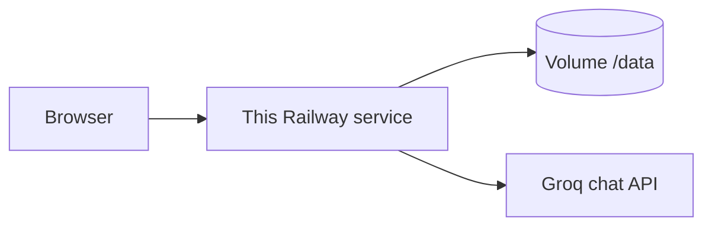

# Deployment plan

How to put this app on a public URL. The target is one Railway service, one persistent disk, and the Groq key already used for answers. Embeddings stay on that service. The browser still talks only to this app.

This is a single-instance deploy. `nutrition.db` is one SQLite file, the guidance index is loaded into that process, and a Railway volume attaches to one replica. A second replica would not share the disk safely.

## What has to be true before the first deploy

| Check | Why |
| --- | --- |
| `npm test` passes on the commit you push | The image is that commit. A red tree should not become the public process |
| `OPENAI_API_KEY` works against `https://api.groq.com/openai/v1` with `openai/gpt-oss-120b` | The scope classifier and the answer model both use it. Embeddings do not |
| The four corpus URLs in `src/lib/corpus.ts` still return a body | The first release fetches them. An empty body exits before `next start` |
| The service has at least 2 GB RAM | The q8 Nomic file is 144 MB. ONNX Runtime plus Next.js need more than that while the first ingest embeds about 700 chunks |
| The volume is at least 1 GB | Weights (~145 MB), raw documents, `guidance.db`, `nutrition.db`, and `llm-budget.json` |
| One replica | SQLite writes and the in-memory index assume one process |
| Healthcheck is off, or its timeout is at least 20 minutes, for the first release | Ingest finishes before the server listens. A short healthcheck marks that release failed |

Local embedding of this corpus, with the weights already on disk, took about three minutes. The first release also downloads the weights and fetches the four documents, so budget fifteen minutes before the URL answers.

## What is not in git

`.gitignore` excludes the files the volume has to hold. The image does not contain them.

| Path | Produced by |
| --- | --- |
| `DATA_DIR/guidance.db` | `npm run ingest` |
| `DATA_DIR/nutrition.db` | First conversation write |
| `DATA_DIR/models/` | First on-device embed. q8 weights for `nomic-ai/nomic-embed-text-v1.5` |
| `DATA_DIR/raw/` | The fetch step inside ingest |
| `DATA_DIR/llm-budget.json` | The Groq budget ledger |
| `.env` | Never. Set the same names as Railway variables |

`data/chunks/` in the repo is the local record. Ingest on Railway writes a fresh `DATA_DIR/chunks/chunk.json` from the fetch. It does not read the copy in git.

## Railway service

`railway.toml` already sets Nixpacks, `npm run build`, and `sh scripts/release.sh`.

Create one service from this repo. Attach a volume mounted at `/data`. Set the variables below on the service, not in a committed file. Generate a Railway domain. Leave the replica count at 1.

| Variable | Value |
| --- | --- |
| `OPENAI_API_KEY` | The Groq key. Mark it secret |
| `OPENAI_BASE_URL` | `https://api.groq.com/openai/v1` |
| `OPENAI_MODEL` | `openai/gpt-oss-120b` |
| `EMBEDDING_MODEL` | `local:nomic-ai/nomic-embed-text-v1.5` |
| `EMBEDDING_DIMENSIONS` | `768` |
| `DATA_DIR` | `/data` |

Do not add a `NEXT_PUBLIC_` variable. The key, the base URL, and the model id stay on the server. `src/lib/release.ts` exits before `next start` when `OPENAI_API_KEY` is missing.

`next start` listens on `PORT` when that variable is set, and Railway sets it. The last line of `scripts/release.sh` is `exec npx next start`. On the first deploy log, confirm the printed port is Railway's `PORT`. If it prints `3000` while the proxy expects another port, change that line to:

```sh
exec npx next start --hostname 0.0.0.0 --port "${PORT:-3000}"
```

Nixpacks should use its default Node image (glibc). `better-sqlite3` compiles at install time, and `onnxruntime-node` ships glibc binaries. An Alpine image is the wrong base for those two packages.

## What the release command does

`scripts/release.sh` loads nothing from the browser. It runs `scripts/ensureIndex.ts`, then replaces itself with `next start`.

1. Refuse to continue when `OPENAI_API_KEY` is empty.
2. If `DATA_DIR/guidance.db` is missing, or its mtime is older than `src/lib/corpus.ts`, run `npm run ingest`.
3. Ingest fetches the four documents into `DATA_DIR/raw/`, chunks them, downloads the q8 weights into `DATA_DIR/models/` if they are not there, and writes a temporary index.
4. The temporary index replaces `guidance.db` only after the embed finishes. A failed fetch, a thin extract, or a failed embed leaves the previous file in place and exits non-zero.
5. A non-zero exit happens before `next start`. Railway keeps the previous deployment.

### Every later deploy re-ingests with the current check

`indexNeedsIngest` compares mtimes. `src/lib/corpus.ts` lives in the image. Its mtime is the build time. `guidance.db` lives on the volume, with the mtime of the last successful ingest. A new image is newer than that file, so the next deploy runs ingest again even when the four URLs did not change.

That is safe and slow. Each push pays the fetch and the embed, and the healthcheck has to stay long enough for that.

To skip ingest when the corpus text is unchanged, store a content hash of `src/lib/corpus.ts` next to the index on the volume and compare hashes instead of mtimes. Do that before expecting a short restart. Until then, treat every deploy as a cold ingest.

## Request path after the server is up



A question embeds on the service with the weights under `/data/models`. The answer and the scope classifier go to Groq. Citations are built in `ground.ts` on the service. The client bundle does not contain the key.

`gpt-oss-120b` on this key is capped in `src/lib/llmBudget.ts`: 30 requests and 8,000 tokens per minute, 1,000 requests and 200,000 tokens per day. The ledger is `/data/llm-budget.json`, so a restart does not reset the day. This URL is for a demo and a small number of people, not an open multi-user launch.

## First deploy

1. Push the commit you tested.
2. Confirm the volume is mounted at `/data` and `DATA_DIR=/data` before the release starts. A release that writes `guidance.db` onto the container disk loses it on the next deploy.
3. Watch the release log for `guidance index rebuilt`, then a Next ready line on Railway's port.
4. Open the generated domain.

If the release fails, read the log before retrying. The usual stops are a missing key, a corpus URL that returned an empty body, a native-module build failure, or the process being killed for memory during the embed. The volume's previous `guidance.db`, if one existed, is still the old file.

## Checks on the public URL

Run these in the browser, the same way as the phase 9 checks, against the Railway domain.

| Step | Expect |
| --- | --- |
| Load `/` | The composer is usable. The sources panel is empty |
| Ask how long cooked chicken can stay in the fridge | An answer with a storage citation: document name, publisher, year, and a link that opens the public chart |
| Ask for a daily calorie target | The decline label and the professional sentence. The panel says there are no claims |
| Ask something the four documents do not cover | The not-in-guidance label, and the bubble names the documents searched |
| Reload with `?c=` still set | The thread and the selected citations return |
| Network log for one turn | Requests go to this domain only. No call to Groq from the browser, and no key in the page source |

Then, from a laptop:

```bash
EVAL_BASE_URL=https://<railway-domain> npm run eval
```

Fill `docs/failure-log.md` from that run. A deploy that has not been scored against the frozen set is not finished. The October local tally does not cover the public process.

## Later changes

| Change | What to do |
| --- | --- |
| Prompt, chunking, `k`, `MIN_SCORE`, or the embedding model | Deploy, then `npm run eval` against the public URL, then update `docs/failure-log.md` |
| Corpus URL or publisher text in `src/lib/corpus.ts` | The next release re-ingests. Confirm the new `guidance.db` is on the volume before calling the URL healthy |
| Groq key rotation | Replace `OPENAI_API_KEY` on the service and redeploy. Do not put the new key in git |
| The service runs out of the daily token cap | Wait for 00:00 UTC, or raise the cap in `llmBudget.ts` only if the Groq account actually allows it. The file on the volume is the ledger |

## Out of scope for this plan

A second region, autoscaling, a hosted vector database, and an embedding API. The index is a few hundred vectors. Exact cosine in this process is the design. Moving embeddings off the service would mean a new `EMBEDDING_MODEL` that is not a `local:` id, a matching `EMBEDDING_DIMENSIONS`, and a full re-embed, because the stored width would no longer be 768.
